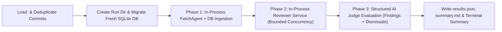

# Design Document: Built-in `sashiko benchmark` Command

## 1. Objective & Motivation

Previously, running a Sashiko benchmark required a fragile, manual multi-step workflow:
1. Moving or deleting the active `sashiko.db` database (`mv sashiko.db sashiko.db.bak`).
2. Starting a separate `sashiko` server daemon in the background.
3. Running a separate binary (`cargo run --bin benchmark -- --file <path>`) that submitted commits over HTTP (`POST /api/submit`), polled `sashiko.db`, and wrote a bare JSON array to `benchmark_results.json` in the working directory.

Additionally, the previous benchmark evaluator had several telemetry blind spots and accounting bugs:
- **Multi-entry commit double-counting**: When a commit appeared multiple times in a benchmark suite (because a single commit introduced multiple distinct bugs), its token usage, duration, turns, concerns, and findings were summed once per entry instead of once per unique commit.
- **Finding + bug double-counting**: `process_entry` summed both `findings` rows and `bugs` rows for the same review, inflating `findings_count` and mixing patch-introduced findings with pre-existing findings.
- **No provenance or run metadata**: `benchmark_results.json` lacked the Sashiko commit SHA, prompt bundle hash, model/provider/effort configuration, timestamp, and database path.
- **No miss diagnosis or stage attribution**: When a bug was `MISSED`, the output could not distinguish whether the bug was never raised by any specialist stage (`not_raised`) or was raised by a specialist stage and wrongly dismissed as a false positive (`wrongly_dismissed`). When a bug was `DETECTED`, the output did not record which finding, severity, specialist stage, or prompt guide caught it, nor how many unmatched/extra findings (noise) were emitted on the same commit.
- **Missing cache and distribution metrics**: Cached input tokens (`tokens_cached`) and P50/P90/Max latency and token distributions were omitted.

This design replaces the standalone `src/bin/benchmark.rs` binary with a self-contained `sashiko benchmark <FILE>` subcommand that automatically provisions and preserves a per-run database and artifact directory under `benchmarks/runs/`.

---

## 2. CLI Interface

```text
sashiko benchmark [OPTIONS] <FILE>
```

### Arguments & Options
- `<FILE>`: Path to the benchmark JSON file (e.g., `benchmarks/benchmark_tiny.json`). Also accepts `-f` / `--file <FILE>` for backwards compatibility.
- `-r, --repo <REPO>`: Target Git repository path or URL for fetching missing benchmark commits (defaults to `settings.git.repository_path`, with remote fallback to `https://git.kernel.org/pub/scm/linux/kernel/git/torvalds/linux.git`).
- `--db <PATH>`: Explicit SQLite database path. When omitted, a fresh database is created inside the preserved run directory.
- `--output-dir <DIR>`: Override the run artifact directory (default: `benchmarks/runs/<YYYYMMDD-HHMMSS>_<sashiko-sha>_<suite>/`).
- `--analyze-only`: Skip patch ingestion and review execution; only run AI judge evaluation on existing review results in `--db` (or the latest run database for `<FILE>`).
- `--concurrency <N>`: Override `review.concurrency` for both review execution and AI judge evaluation.
- `--ai-provider <PROVIDER>`: Override `ai.provider`.
- `--effort <EFFORT>`: Override reasoning effort (`mid`, `high`, or `dynamic`).
- `--report-preexisting`: Enable pre-existing bug verification (`linux_bug.enabled = true`). Automatically enabled when the benchmark filename contains `preexisting`.
- `--settings <PATH>`: Path to settings file.
- `--prompts <PATH>`: Path to prompt bundle directory.
- `--format <text|json>`: Terminal output format (`text` default, `json` for machine output).
- `--color <auto|always|never>`: Terminal color mode.

---

## 3. Automatic Database & Run Directory Preservation

Every benchmark run (unless `--analyze-only` reuses an existing directory) creates a dedicated, gitignored run directory inside the Sashiko repository:

```text
benchmarks/runs/<YYYYMMDD-HHMMSS>_<sashiko-sha>_<suite>/
├── sashiko-<YYYYMMDD-HHMMSS>-<sashiko-sha>.db
├── results.json
└── summary.md
```

- **Sashiko Git SHA (`<sashiko-sha>`)**:
  - Embedded at compile time via `build.rs` (`SASHIKO_GIT_SHA`, 12-character hex SHA) and refreshed at runtime via `git rev-parse --short=12 HEAD` when run inside a Git checkout, appending `-dirty` if `git status --porcelain` is non-empty.
- **Database Preservation**:
  - `settings.database.url` is automatically pointed to `benchmarks/runs/<run_id>/sashiko-<YYYYMMDD-HHMMSS>-<sashiko-sha>.db`.
  - Temporary review worktrees are isolated under `benchmarks/runs/<run_id>/worktrees/` and cleaned up when the run finishes so concurrent benchmark runs never collide with a running daemon or with each other.
  - For convenience and backwards compatibility with existing scripts, `results.json` is also written to `benchmark_results.json` in the current working directory.

---

## 4. Self-Contained In-Process Execution Architecture



1. **Deduplicated Commit Ingestion**:
   - Entries in `<FILE>` are parsed into `BenchmarkEntry`. Unique commit SHAs are extracted in order so commits referenced by multiple benchmark entries (e.g., multi-bug commits) are ingested and reviewed exactly once.
   - Outbound side effects (`smtp`, `forge`) are disabled in the benchmark's in-memory `Settings`.
   - `FetchAgent` resolves each commit locally in `settings.git.repository_path` (fetching from `--repo` or upstream Linux kernel git only if a commit is missing locally), extracts the patch and parent baseline (`Event::PatchSubmitted`), and persists the patchset and patch rows via `Ingestor::ingest_benchmark_article`.
2. **In-Process Review Loop**:
   - `Reviewer::new(db, settings)` runs in-process against the isolated benchmark database.
   - The orchestrator monitors patch/review states across all unique commits until all reach a terminal status (`Reviewed`, `Failed`, `Skipped`, `Cancelled`), reporting live progress.
3. **Structured AI Judge & Lineage Extraction**:
   - For each unique commit, review telemetry is loaded once from `reviews`, `findings`, `ai_interactions`, and `tool_usages`, including the embedded `review_map` JSON (`planned_stages`, `selected_guides`, per-stage token/turn/duration metrics, `findings` with `stages`/`prompts` provenance, and `dismissed_concerns`).
   - For each benchmark entry, `BenchmarkEvalSession` presents the ground-truth `problem_description` alongside:
     1. Numbered reported findings (`[F1]`, `[F2]`, ...) with severity, `preexisting` flag, originating stages, and explanation.
     2. Numbered dismissed/unreported concerns (`[D1]`, `[D2]`, ...) with originating stage and dismissal reasoning.
   - The judge returns a validated JSON verdict (`status`, `matched_finding_index`, `miss_reason`, `dismissed_by_stage`, `explanation`).

---

## 5. Improved Results Representation

### 5.1 Run Metadata (`metadata`)
- `run_id`, `started_at`, `finished_at`, `wall_clock_secs`
- `sashiko_version`, `sashiko_git_sha`, `sashiko_git_dirty`, `prompts_git_hash`
- `benchmark_file`, `total_entries`, `unique_commits`
- `project`, `ai_provider`, `model`, `effort`, `concurrency`, `report_preexisting`
- `database_path`, `results_json_path`, `summary_md_path`

### 5.2 Aggregate Summary (`summary`)
- **Detection Accuracy**:
  - `detected`, `partially_detected`, `missed`, `not_reviewed`, `skipped`
  - `exact_detection_rate_pct` (`detected / evaluated`), `total_detection_rate_pct` (`(detected + partially_detected) / evaluated`)
- **Miss Diagnosis Breakdown**:
  - `missed_not_raised`: Never flagged by any specialist stage.
  - `missed_wrongly_dismissed`: Flagged by a specialist stage, then dismissed as a false positive during specialist analysis, `verification`, or `post-verification`.
  - `missed_preexisting_filtered`: Flagged as pre-existing (`preexisting = true`) rather than a patch-introduced finding.
  - `missed_review_failed`: Patch review failed or was skipped before completion.
- **Precision & Noise Metrics (Deduplicated Per Unique Commit)**:
  - `total_patch_findings`, `total_preexisting_findings`
  - `matched_findings` vs `unmatched_extra_findings` (noise / additional findings beyond the ground-truth bug)
  - `avg_patch_findings_per_commit`, `clean_target_only_commits` (commits where only the ground-truth bug was reported with zero extra findings)
  - `findings_by_severity` (`critical`, `high`, `medium`, `low`)
  - `total_concerns_raised`, `total_concerns_dismissed`, `concern_to_finding_conversion_pct`
- **Stage & Subsystem Breakdown**:
  - `detections_by_stage`: Count of detected bugs attributed to each specialist stage (`execution-flow`, `resources`, `locking`, `security`, `hardware`, etc.) and verification path (`verification` vs `post-verification`).
  - `false_dismissals_by_stage`: Count of `wrongly_dismissed` misses by stage.
  - `by_subsystem`: Per-subsystem detection counts and rates.
- **Resource & Latency Distributions (Deduplicated Per Reviewed Commit)**:
  - `total_tokens_in`, `total_tokens_out`, `total_tokens_cached`, `cache_hit_rate_pct`
  - `tokens_in`, `tokens_out`, `tokens_cached`, `turns`, and `duration_secs` distributions with `mean`, `p50`, `p90`, and `max`.

### 5.3 Per-Entry Record (`entries[]`)
Retains all legacy keys (`commit`, `problem_description`, `found`, `status`, `explanation`, `findings_count`, `concerns_count`, `tokens_in`, `tokens_out`, `turns`, `duration_secs`) while adding:
- `subsystem`, `fixed_by`
- `tokens_cached`, `dismissed_concerns_count`, `patch_findings_count`, `preexisting_findings_count`, `extra_findings_count`
- `matched_finding`: `{ index, problem, severity, preexisting, origin, stages, prompts }`
- `miss_reason`: `"not_raised" | "wrongly_dismissed" | "preexisting_filtered" | "review_failed" | null`
- `dismissed_by_stage`: Stage that dismissed the concern when `miss_reason == "wrongly_dismissed"`
- `planned_stages`, `selected_guides`
- `findings`: Full list of findings emitted for the commit
- `dismissed_concerns`: Full list of dismissed concerns for the commit
- `stages`: Per-stage execution summary from `review_map`
